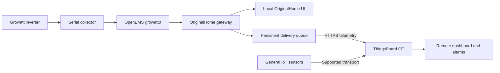

> Release direction updated 14 November 2026: [energy-only release plan](release_1_energy_cloud_plan.md) and [cloud server requirements](cloud_server_requirements.md) are authoritative for release 1. ThingsBoard and LoRa are deferred; local OpenEMS, OriginalHome cloud, a physical gateway and a technical VPP pilot are the new baseline. Conflicting scope, topology and estimates below are historical.

# ThingsBoard integration plan

Draft: 13 November 2026. Scope: integrate ThingsBoard into the existing OriginalHome platform, starting with the working Growatt installation on `original-volt-gateway`.

## Direction and boundaries

Use ThingsBoard CE as the central service for remote dashboards, retained telemetry, site/device organization and alarms. Keep OriginalHome as the local interface and gateway, and OpenEMS as the energy integration and eventual control owner. Deploy ThingsBoard on a separate Linux host for the pilot; size it after choosing retention and site count. A fully local deployment on a suitable server remains an alternative.

Start with monitoring and operational reliability. This integration milestone does not close the broader platform requirement for qualified physical energy control. Growatt write support and automatic energy strategies remain separate, mandatory qualification work under the existing implementation plan.

| Responsibility | Owner |
| --- | --- |
| Read Growatt equipment | Existing read-only serial collector |
| Expose normalized energy channels and equipment freshness | OpenEMS `growatt0` |
| Local UI, local history, telemetry delivery buffer | OriginalHome gateway |
| Remote history, dashboards, device inventory and alarms | ThingsBoard |
| Energy decisions and equipment writes, once qualified | OpenEMS |
| General IoT integration | Direct supported device transport or ThingsBoard IoT Gateway when needed |

The Pi initiates outbound connections. ThingsBoard does not need direct access to the Pi's OpenEMS REST port. Start with separate local and remote interfaces and an authenticated link from OriginalHome to the ThingsBoard dashboard. Unified login and embedded dashboards are later work requiring a defined identity design.

## Current implementation

- The live path is serial collector → OpenEMS `growatt0` → OriginalHome. On 13 November, correcting an obsolete adapter ID restored measurements through the OriginalHome API.
- `gateway/core.py` already posts batches of up to 100 samples to `/api/v1/{device-token}/telemetry` with collection timestamps. Delivery is at least once; a retry can repeat a sample.
- `gateway/__main__.py` has separate collection and delivery workers. Forwarding is enabled with `THINGSBOARD_URL` and `THINGSBOARD_TOKEN`.
- SQLite survives process restarts. At the default five-second interval, 17,280 samples represent about 24 hours. Capacity is shared by retained history and queued measurements; overflow deletes the oldest rows, including unsent rows, and counts dropped pending samples.
- Equipment timestamps are checked locally, but only the five normalized energy values currently reach ThingsBoard. Source quality, heartbeat and delivery diagnostics need implementation.
- Forwarding was not configured during the latest Pi verification. No ThingsBoard server, account or dashboard is assumed to exist.
- The current delivery status can say `reachable` when the queue is empty without making a network request. Replace that implication with last confirmed upload time and queue status.

## Entity and telemetry contract

For the first installation, create one ThingsBoard site asset and one ordinary device representing the site's energy gateway. Do not mark it as a ThingsBoard gateway merely because the physical computer is a gateway; child-device gateway APIs are not needed for this first path.

Use a customer per household/organization and a site asset beneath it. Begin with one operator tenant and test access between two customers. If independent integrators become a requirement, evaluate a tenant per integrator using the pinned edition's actual permission model. ThingsBoard remains the authority for these remote assignments; the Pi stores only its provisioned identifiers.

| Field | Meaning |
| --- | --- |
| `site_id`, `gateway_id` | Stable provisioned identifiers; do not derive identity from a changing IP address |
| `schema_version` | Version of the OriginalHome telemetry contract |
| `component_id` | `growatt0` for this installation |
| `data_origin` | `equipment`; simulator data must remain isolated |
| `inverter_model`, software versions | Inventory attributes, updated on provisioning or version change |
| `solar_w` | PV input power; currently DC-side, not a verified AC balance term |
| `load_w`, `grid_w`, `battery_w` | W; grid positive means import, battery positive means discharge |
| `battery_soc` | Percent, range 0–100 |

Publish inventory as attributes and changing measurements as telemetry. Keep the existing energy keys for compatibility. Do not upload passwords, tokens, raw configuration or unqualified device identity as verified inventory. Preserve the reported/nameplate serial discrepancy in the commissioning record.

Continue using UTC epoch milliseconds in telemetry envelopes. Add the equipment observation time as `equipment_sample_ts`; keep collection time distinct. Show dashboard times in Europe/Bucharest while storing UTC. Do not relabel old replayed measurements with the reconnect time.

Add a separate health stream with proposed fields `source_available`, `equipment_sample_ts`, `pending_samples`, `dropped_samples` and gateway heartbeat time. Heartbeats must continue when serial reads fail. Bound health buffering independently so failures cannot exhaust the measurement queue. Never fill missing energy values with zero or carry old values forward as new readings.

## Delivery phases

| Phase | Deliverables | Exit evidence | Indicative effort |
| --- | --- | --- | --- |
| 1. Hosting and provisioning | Pinned CE deployment, required dependencies, HTTPS, persistent volumes, operator/customer accounts, site asset, gateway device and token | Authenticated dashboard access; isolated test customers; database backup restored to a test instance | 1–2 days |
| 2. First live telemetry | Enable existing HTTPS forwarder on the Pi; check units, signs, timestamps and destination | ThingsBoard values agree with local API within sampling delay; updates continue after service restart | 1–2 days |
| 3. Health and delivery reliability | Health stream, accurate delivery status, bounded retries/backoff, freshness-aware alarms and queue visibility | Serial disconnect, WAN outage, replay and overflow scenarios pass without false live status | 2–4 days |
| 4. Dashboard and local navigation | Site summary, five energy values, history, freshness indicator, alarms and authenticated remote dashboard link | Owner can distinguish current, stale and disconnected states; no stale value presented as current | 1–2 days |
| 5. Operations and one IoT sensor | Versioned dashboard/profile/rule exports, backup/restore runbook, token rotation, one general sensor | Repeatable onboarding, customer access tests, restore drill and seven-day pilot observation | 2–4 days plus observation |

Effort is a planning estimate for one engineer with host and account access. It excludes hardware write qualification, a custom portal, SSO and equipment control. This sequence refines the ThingsBoard portion of the broader implementation plan; it does not replace that plan's energy-control gates.

### Phase 1: prepare the service

Use the selected release's official Docker Compose installation and its documented dependencies; pin image versions and export configuration. Keep secrets outside version control and use a separate device token for each gateway. Restrict administration and database access; expose only the required authenticated service endpoints. Configure retention before the pilot and measure database growth.

Proposed starting retention: 30 days of raw cloud telemetry, with no aggregate retention promise until supported configuration and storage cost are verified. At five-second sampling, one site produces 17,280 measurement envelopes per day and 86,400 energy key-values per day, before health data. Measure actual storage and write load before expanding.

### Phase 2: connect the existing forwarder

1. Provision the stable site/gateway identity and device profile in ThingsBoard.
2. Back up the Pi's private environment file. Record the current data directory and pending count without printing secrets.
3. Add `THINGSBOARD_URL` and the device token to `~/.config/originalhome/gateway.env`; restart the user service `originalhome-gateway`.
4. Verify new measurements in both `/api/overview` and ThingsBoard with matching timestamps and units.
5. Restart the gateway and confirm delivery resumes without corrupting history.

Existing rows collected while forwarding was disabled have `pending=false`: enabling forwarding will send new samples, not automatically backfill earlier history. Historical import, if requested, must be an explicit bounded operation. When changing destinations, drain the queue or use a fresh data directory; do not send an old site's queued history to a new device.

### Phase 3: make cloud status trustworthy

Treat gateway reachability, equipment freshness and upload backlog as separate signals. ThingsBoard device activity indicates traffic, and replayed telemetry can create activity while the physical source is unavailable. Dashboards and alarm logic must evaluate source timestamps as well as receipt time.

Proposed initial thresholds: mark energy stale after 30 seconds without a fresh equipment sample; send health every 15 seconds and flag gateway heartbeat absence after 60 seconds. Validate these against observed timing before freezing the profile. Require fresh valid samples to clear an equipment alarm; backlog replay alone must not clear it. Handle out-of-order health events without overwriting newer status, and suppress historical threshold notifications during replay according to an explicit rule policy.

Track last confirmed upload, oldest pending age, queue count and unsent drops. Use capped exponential retry backoff with jitter for delivery failures; surface invalid credentials separately from temporary connection failure. Local collection continues during upload failures. A successful transport response confirms ingestion acceptance, not that every dashboard or downstream alarm completed.

Retain the existing bounded buffer initially. Document its approximately 24-hour measurement capacity and loss policy. If longer outages must be covered, increase capacity after measuring disk usage or split local history from the outbound queue. Verify the forwarder can drain faster than new data arrives at the pilot's server limits.

### Phase 4: user experience

The remote site dashboard shows current energy values, a 24-hour trend, configurable history range, last equipment sample age, gateway heartbeat, backlog and active alarms. Make grid import/export and battery charge/discharge signs explicit. Label PV input power accurately; do not infer billing-grade energy totals from sparse power readings.

OriginalHome remains available locally during internet or ThingsBoard outages. Add a cloud delivery indicator with last successful upload and queue size, plus a configurable dashboard link. Keep device tokens server-side. Any future custom cloud API must authorize site access from the signed-in user; accepting a submitted site ID is insufficient.

### Phase 5: operations and general IoT

Add one actual sensor using a supported ThingsBoard device transport. Introduce ThingsBoard IoT Gateway only when its connectors or local protocol conversion are needed. Avoid a second integration path to Growatt or a competing energy writer.

Store sanitized deployment definitions, dashboard exports, device profiles, rule configurations and onboarding instructions in the repository. Back up the ThingsBoard database and required persistent assets/configuration, and the Pi configuration plus SQLite using a safe backup procedure. Restore into a separate environment with duplicate notifications and physical actions disabled. Record measured restore time and data loss window.

## Acceptance scenarios

| Scenario | Required result |
| --- | --- |
| Normal operation | Local and cloud values match within sampling delay; equipment timestamps advance |
| Serial adapter disconnected | Local source becomes unavailable; cloud energy becomes stale even while gateway heartbeats continue |
| Adapter returns with a different ID | Clear diagnostic identifies missing configured path; intentional re-selection restores data |
| WAN or ThingsBoard unavailable | Local UI and collection continue; pending count grows within the documented limit |
| Reconnection and replay | Original timestamps retained; backlog drains; old samples do not imply live equipment or clear newer alarms |
| Outage longer than buffer capacity | Oldest unsent rows may be lost; dropped count and history gap are visible |
| Invalid or rotated token | Clear delivery failure; local acquisition unaffected; new token restores delivery |
| Pi reboot | Edge, collector and OriginalHome recover; serial path and fresh readings verified |
| Two customer accounts | UI and direct API access cannot expose the other customer's devices, history or dashboards |
| Backup restore | Inventory, retained telemetry and dashboard configuration recover in an isolated test deployment |

## Later supervisory control

Only after the exact Growatt hardware and OpenEMS write path are qualified, design a separate request adapter for a small allowlist of supervisory operations. Every request needs authenticated site scope, unique ID, expiry, bounded parameters and an override lease where relevant. Track requested, accepted/rejected and physically observed outcomes independently. Reject stale or duplicate requests and never replay queued physical actions after an outage. OpenEMS owns the local strategy and fallback behavior.

Do not enable ThingsBoard RPC buttons or remote energy writes as part of the telemetry milestone. The existing application correctly reports control disabled; enabling control requires its own implementation and acceptance evidence.

## Decisions needed before deployment

1. Existing ThingsBoard instance or new host; hosted Linux or a separate local server?
2. Initial number of homes/sites and which users need remote access?
3. Required cloud retention and acceptable outage/history loss window?
4. First general IoT sensor and whether notifications beyond the dashboard are needed?

Planning defaults: separate Linux host, CE, one pilot home plus isolated access-test customer, 30-day raw retention target, five-second measurements, existing approximately 24-hour local buffer, monitoring dashboard first. These are proposed defaults, not deployed settings or authorization to purchase hosting.

## Reference documentation

Verify these contracts against the chosen pinned release before implementation:

- [ThingsBoard CE Docker installation](https://thingsboard.io/docs/installation/docker/)
- [HTTP device API](https://thingsboard.io/docs/reference/http-api/)
- [HTTP attributes API](https://thingsboard.io/docs/reference/http-api/attributes/)
- [Connectivity status](https://thingsboard.io/docs/user-guide/connectivity-status/)
- [Alarms](https://thingsboard.io/docs/user-guide/alarms/)
- [REST API](https://thingsboard.io/docs/reference/rest-api/)

Local implementation references: `gateway/core.py`, `gateway/__main__.py`, `main_planning/growatt_connection.md`, and `main_planning/implementation_plan_1_to_3_months.md`.
